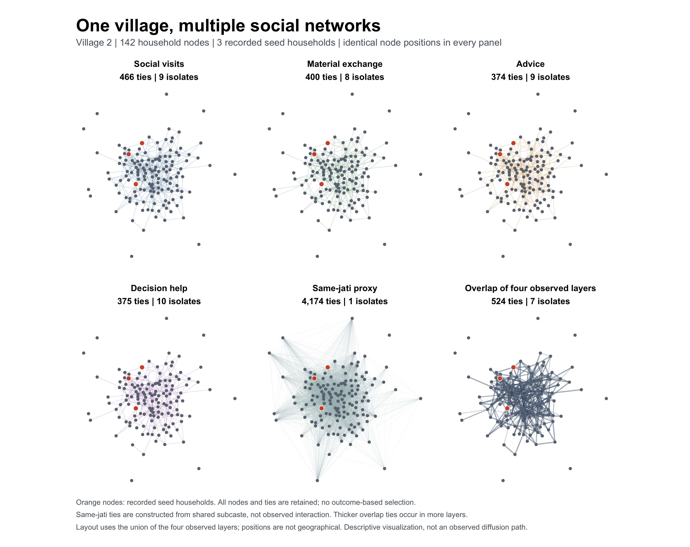
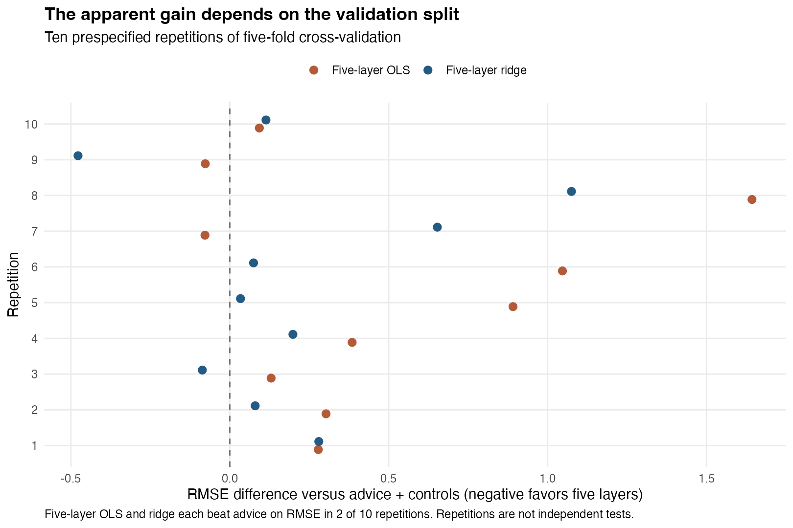

# How information travels through social relationships

[English](README.md) · [中文](README_ZH.md)

A household may borrow rice from one neighbour, visit another and ask someone else for advice. When a message enters a village, which of these relationships helps us understand how far it spreads?

Chandrasekhar, Chaudhary, Golub and Jackson (2026) study this question in Indian villages, treating each kind of relationship as a separate network. I reproduce part of their analysis and then ask one follow-up question.

[Paper (PNAS)](https://doi.org/10.1073/pnas.2534923123) · [Preprint](https://arxiv.org/pdf/2412.11957) · [Author data and code](https://github.com/v-asu/multiplexing-and-diffusion-replication-package)



*The same 142 households in one village, drawn with different relationships. Orange dots are the households that first received the information.*

## Key findings

**The reproduction matches.** I rebuilt the village networks from the raw data and reproduced the nine models behind the paper's Table S2. The results match the published numbers, and advice relationships give the closest fit, as in the paper.

**More relationship types did not reliably help prediction.** I asked whether using all five basic relationship types predicts a new village's response better than advice alone. Across different ways of splitting the 68 villages, there was no consistent improvement. With this many villages, the result depends on which villages are used.

## Open questions

- Network information helps prediction only a little overall: the advice model is only slightly more accurate than simply guessing the average village.
- The answer changes when I keep only villages where the recorded and assigned numbers of first-informed households agree, so data recording deserves a closer look.
- I have not reproduced the paper's theory, simulations or its own model-selection procedure, so this is a narrower check rather than a test of the paper's main claims.

<details>
<summary>Expand: published Table S2 and reproduced results</summary>

Values below come directly from the repository's [regression comparison](results/figure2_table_s2_comparison.csv), corresponding to Figure 2 and Table S2, and are shown to three decimals. Parentheses contain standard errors; R² describes model fit.

| Relationship or network measure | Paper: coefficient (SE) | This project: coefficient (SE) | R²: paper / project |
|---|---:|---:|---:|
| Social visits | 4.266 (1.820) | 4.266 (1.820) | 0.194 / 0.194 |
| Material exchange | 5.466 (2.326) | 5.466 (2.326) | 0.254 / 0.254 |
| Advice | 6.410 (2.416) | 6.410 (2.416) | 0.313 / 0.313 |
| Decision assistance | 3.137 (2.226) | 3.137 (2.226) | 0.161 / 0.161 |
| Shared subcaste | 1.161 (1.559) | 1.161 (1.559) | 0.110 / 0.110 |
| Union | 1.110 (1.752) | 1.110 (1.752) | 0.110 / 0.110 |
| Intersection | 2.220 (2.200) | 2.220 (2.200) | 0.139 / 0.139 |
| PCA backbone | 1.752 (2.123) | 1.752 (2.123) | 0.119 / 0.119 |
| Directed total links | 2.158 (1.453) | 2.158 (1.453) | 0.131 / 0.131 |

Coefficients, standard errors, p values and R² match at the reported precision in all nine models, each with 68 villages. Village 62 has no recorded initially informed households and is excluded as in the authors' implementation. Individual p-value comparisons are in the CSV above.

All 552 rebuilt adjacency matrices match the authors' matrices exactly. The 544 nonmissing seed-centrality values agree within about 9.4 × 10⁻¹³. The PCA backbone measure is taken from the authors' files rather than rebuilt. The theoretical results, simulations and Table 1's model-selection procedure are outside this reproduction.

[Verification record](docs/VERIFICATION.md) · [Full numerical discussion](docs/DETAILS.md)

</details>

<details>
<summary>Expand: additional prediction checks</summary>

These are this project's extension results, with no corresponding paper values. Each village is left out in turn: the models use the remaining villages to predict its registration-call count.

| Model | Leave-one-village-out RMSE | MAE |
|---|---:|---:|
| Training-sample mean | 11.611 | 8.242 |
| Advice + controls | 11.376 | 8.316 |
| Five basic layers, OLS | 11.659 | 8.231 |
| Five basic layers, ridge | 11.227 | 8.032 |

Both errors are in calls, and lower is better. RMSE gives greater weight to large errors; MAE is the average absolute error. Advice has slightly lower RMSE than the mean baseline but slightly higher MAE, so its advantage does not hold across both measures.

Ridge reduces RMSE by about 1.3% relative to advice. Across ten repeated five-fold comparisons, however, each five-layer model beats advice on RMSE only twice. Standardization and tuning use training data only. These comparisons use different subsets of the same villages, not an independent sample of newly collected villages, and differ from the authors' Table 1 model-selection procedure.



[Prediction scores](results/prediction_metrics.csv) · [Seed-count checks](results/measurement_sensitivity.csv) · [Uncertainty intervals](results/corrected_resampling_intervals.csv)

</details>

## Run the project

R 4.6.0 and Python 3.10+. Package versions are pinned in `renv.lock`.

```sh
Rscript setup.R
python3 code/fetch_inputs.py
python3 code/fetch_network.py
python3 run.py
```

Inputs are downloaded to `private_inputs/`; results are written to `results/`. The author data and scripts remain at their source; see [source terms](docs/SOURCE_AUDIT.md).
